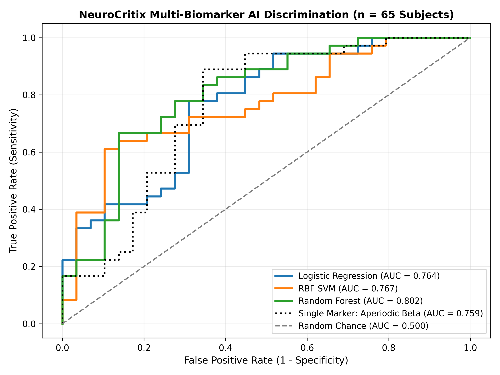
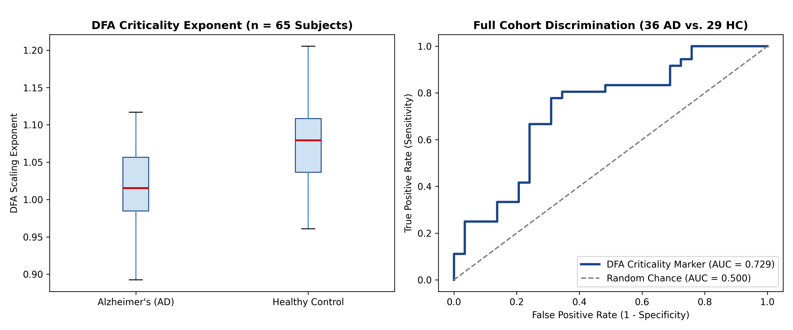

# EcoCritix
**Early Detection of Ecosystem Collapse via Ecological Criticality & Resilience Complexity**

**Author:** Rejitha Renjan *(Independent Researcher | MSc Zoology)*  
**Live Interactive Prototype:** [Launch EcoCritix App]([https://ecocritix-pulse-lab.base44.app])  
**Status:** Research & Educational Prototype (November 2026)

---

## Overview
**EcoCritix** is a computational ecology and conservation biology prototype designed to detect early warning signals of ecosystem stress before irreversible regime shifts—such as trophic collapse, desertification, eutrophication, or biodiversity loss—become permanent.

Drawing directly from theoretical ecology and complex systems physics, EcoCritix models living ecosystems as open thermodynamic systems operating near critical phase transitions, tracking how ecological resilience erodes under cumulative environmental load.

---

## Core Scientific Framework

### 1. Ecological Criticality & Thermodynamic Negentropy
* **Ecological Criticality:** Healthy ecosystems self-organize near a critical boundary between rigid monoculture and chaotic instability, maximizing nutrient cycling, energy flow, and adaptive resilience.
* **Negentropy & Trophic Bioenergetics:** Ecosystems sustain structural order by capturing solar/chemical free energy and exporting metabolic entropy. Chronic anthropogenic or climatic stress triggers an *entropy cascade* across trophic levels, eroding ecological resilience.

### 2. Quantitative Ecosystem Complexity & Early Warning Metrics
EcoCritix evaluates four nonlinear dynamical signatures from ecological time-series data (such as population dynamics, biomass flux, or acoustic/environmental telemetry):
* **Shannon Diversity / Entropy:** Measures species and functional signal richness (high in resilient biodiverse habitats; drops sharply as keystone interactions simplify).
* **Lempel-Ziv (LZ) Complexity (0–1):** Quantifies algorithmic pattern diversity across ecological fluctuations, falling as system dynamics become overly repetitive prior to collapse.
* **Detrended Fluctuation Analysis (DFA) Exponent:** Captures long-range temporal memory and "critical slowing down" as recovery rates weaken near a tipping point.
* **Power-Law / $1/f$ Scaling Exponent ($\beta$):** Tracks multi-scale spatial and trophic coupling across habitats.

---

## Stochastic Criticality Simulation Model
The interactive simulation modules model ecosystem resilience capacity ($x$) against cumulative environmental stress ($r$) using a bistable cubic stochastic differential equation:

$$\frac{dx}{dt} = -x^3 + x + r + \sigma \xi(t)$$

* **$x$**: Ecosystem negentropy and resilience capacity (healthy baseline $x = 1.2$).
* **$r$**: Cumulative environmental/anthropogenic load parameter (range $-0.5$ to $0.5$).
* **Critical Tipping Point ($R_{CRITICAL}$):** $\frac{2}{3\sqrt{3}} \approx 0.385$.
* **Hysteresis:** Sub-threshold disturbances ($r < 0.385$) allow natural ecological recovery, whereas crossing $R_{CRITICAL}$ triggers a saddle-node bifurcation into a degraded alternative stable state that persists even after stressors are reduced.
* ---

## Empirical Validation Results (OpenNeuro Cohort `ds004504`, *n* = 65)
To validate the theoretical framework on real human electrophysiology, the four NeuroCritix dynamical biomarkers were evaluated on preprocessed resting-state EEG recordings from **65 age-matched subjects** (**36 Alzheimer's Disease [AD]** vs. **29 Healthy Controls [HC]**) sourced from OpenNeuro (`ds004504`, posterior/temporal channels `P3, P4, Pz, O1, O2, T5, T6`).

### 1. Group-Level Statistical Discrimination (Mann-Whitney *U* Test)
All four nonlinear criticality and complexity metrics achieved statistically significant separation (*p* < 0.05) between Healthy Controls and Alzheimer's patients:

| Biomarker Metric | Healthy Control (*n* = 29) | Alzheimer's AD (*n* = 36) | *p*-value | Single-Marker ROC-AUC |
| :--- | :---: | :---: | :---: | :---: |
| **Aperiodic 1/*f* Slope ($\beta$, 15–40 Hz)** | **2.4624** | **1.9163** | **0.00038** | **0.759** |
| **DFA Envelope (Alpha-Beta 8–30 Hz)** | **1.0747** | **1.0205** | **0.00165** | **0.729** |
| **Shannon Spectral Entropy (8–30 Hz)** | **0.4268** | **0.4625** | **0.00362** | **0.712** |
| **Lempel-Ziv Complexity (8–30 Hz)** | **0.2805** | **0.2961** | **0.02403** | **0.664** |

* **Clinical Cognitive Correlation:** Higher DFA long-range temporal correlation (`DFA_Envelope`) correlated significantly with clinical Mini-Mental State Examination (`MMSE`) scores across the cohort (*Spearman r* = **0.344**, *p* = **0.00504**).

### 2. Multi-Biomarker AI Classification (5-Fold Stratified Cross-Validation)
Combining all four empirically validated biomarkers into a **Random Forest** ensemble classifier yielded **`ROC-AUC = 0.802`**, outperforming every individual marker alone (`0.759` peak single-marker AUC) and confirming multi-dimensional criticality breakdown in neurodegeneration.

*Full subject-level empirical metrics are archived in [`NeuroCritix_Full65_Validated.xlsx`](NeuroCritix_Full65_Validated.xlsx).*

---

## Application Architecture
* **Home:** Visual introduction to trophic energy flow, ecological resilience, and early tipping-point detection.
* **Eco Explorer:** Real-time bistable simulation with environmental load controls and acute disturbance ("Nudge") testing.
* **Upload & Dashboard:** Ecological time-series analysis pipeline featuring simulated habitat cohorts, complexity metric cards, spectral scaling charts, and biodiversity reference benchmarks.
* **Comparison:** Side-by-side hysteresis simulation contrasting reversible seasonal disturbance vs. irreversible ecosystem regime shift.
* **Education:** Plain-language reference library connecting zoology, thermodynamics, and bifurcation theory.
  

**Tech Stack:** React, Tailwind CSS, Recharts, Three.js, Base44.

---

## Disclaimer
*EcoCritix is an independent research and educational prototype created for academic demonstration. All analyses and datasets are generated from synthetic simulations and are intended for educational and theoretical modeling purposes.*
